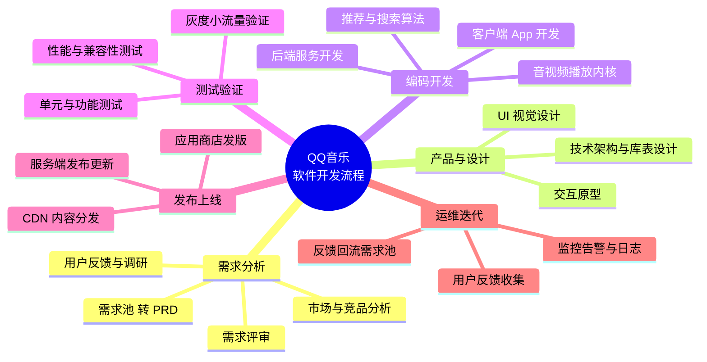
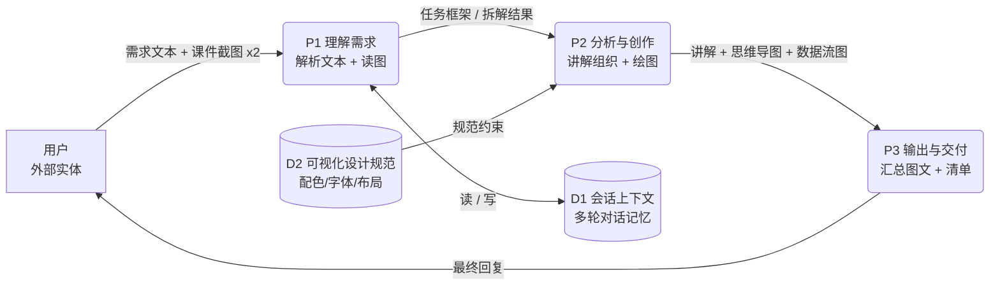

# QQ 音乐软件开发流程解析

> 视角说明：本文按「业务流程分析 + 数据流分析」两套提问框架组织，属于**行业通行实践的通俗化讲解**，不代表腾讯官方内部流程。真实团队分工、灰度比例等细节属未公开信息，标注为 `[待确认]`。

---

## 一、通俗讲解：QQ 音乐是怎么被开发出来的

### 1.1 业务流程视角（回答「业务流程分析」七问）

| 课件问题                           | QQ 音乐的答案（通俗版）                                                                                                                             |
| ------------------------------ | ----------------------------------------------------------------------------------------------------------------------------------------- |
| 有哪些业务流程？目的或目标是什么？              | 六大流程：需求分析（搞清楚用户想听什么歌、要什么功能）→ 产品与设计（画原型、定界面）→ 编码开发（程序员写代码）→ 测试（找 Bug）→ 发布上线（让用户能下载更新）→ 运维迭代（线上盯着，持续改进）。目标：让用户"想听的歌一键就能听到"，同时把会员、广告、数字专辑变现。 |
| 流程如何完成，经过哪些步骤？活动开始 / 结束的条件是什么？ | 一个功能先进入"需求池"，产品经理写成 PRD → **评审通过**才进入设计 → 设计出图后开发排期实现 → 测试验收通过 → **灰度发布**（先给 1% 用户）→ 指标达标才全量。开始条件：需求已立项；结束条件：线上指标达标且无 P0 故障。              |
| 有谁参与？各自完成哪些活动？                 | 产品经理（定需求）、交互/视觉设计师（定样子）、客户端工程师（iOS / Android / PC / 车机）、后端工程师（服务器、曲库、会员与支付）、算法工程师（每日推荐、搜索、音质）、测试工程师、运维/SRE、内容运营与版权团队。                     |
| 有哪些控制流（判断、同步分支、会合）？多个流程之间什么关系？ | 典型判断：需求评审"通过 / 打回"；发布前"灰度指标达标吗？达标→全量，不达标→回滚"。多端（安卓 + iOS）开发是**并行分支**，发版时会合；服务端与客户端有版本兼容约束，需要旧版本兜底逻辑。                                      |
| 用了哪些方式或手段？                     | 敏捷开发（双周迭代、小步快跑）、CI/CD 自动化构建与部署、自动化测试、A/B 实验、Feature Flag（开关控制灰度）。                                                                         |
| 资源与成本如何？各环节增值作用如何？             | 主要资源：人力（研发占比最大）、服务器与带宽（音频/CDN 成本高）、版权采购。增值最大的环节：推荐算法与内容运营（直接决定留存）、需求洞察；纯支撑环节：构建部署、监控。                                                     |
| 流程中是否存在瓶颈或阻塞排队？                | 常见瓶颈：需求评审排队（需求多、评审人力少）、测试环境与真机资源不足、发版窗口受限（应用商店审核）。缓解手段：自动化测试、环境池化、服务端配置化绕过发版。                                                             |

### 1.2 数据流视角（回答「数据流分析」七问）

| 课件问题                       | 对照答案                                                                                         |
| -------------------------- | -------------------------------------------------------------------------------------------- |
| 系统主要完成什么功能？最重要的输入和输出数据是什么？ | 核心功能：把"海量曲库"匹配给"具体的人"。最重要输入 = 用户听歌行为（点击、搜索、跳过、收藏、单曲循环）；最重要输出 = 个性化推荐流与歌单。                    |
| 作为整体与外界环境什么关系？             | 上游：唱片公司 / 版权方（音频与元数据流入）、支付渠道（会员与数字专辑交易）；下游：应用商店（版本分发）、社交平台（分享回流）。                            |
| 能否分解为相对独立的子系统？             | 能：播放器内核、搜索、推荐、评论社区、会员与支付、下载缓存、音质与音效、直播/K 歌等。                                                 |
| 子功能是否还能继续细分？               | 能。以"推荐"为例可再分为：召回（协同过滤 / 内容标签 / 热度）、粗排、精排、重排（去重、打散、多样性），每一层都是独立可替换的模块。                        |
| 每个功能的输入与输出数据是什么？           | 搜索：关键词 + 用户画像 → 排序后的歌曲列表；播放：歌曲 ID + 音质档位 → 音频流 + 播放状态；推荐：行为日志 → 推荐队列。                        |
| 需要长期保存的数据有哪些？如何创建、修改、使用？   | 曲库元数据（版权方导入 + 运营维护）、用户歌单（用户创建/编辑）、播放记录与收藏（客户端埋点写入）、会员订单（支付回调写入）。存储在数据库/对象存储中，被推荐、搜索、结算等模块读取。 |
| 数据从来源到最后去处是否完整？            | 形成闭环：用户行为 → 埋点日志 → 消息队列 → 数据仓库 → 训练推荐模型 → 推荐结果改变用户行为。断点风险：埋点缺失、跨端口径不一致、日志延迟。                 |

### 1.3 一句话总结

> 开发流程解决"**怎么把功能做出来并安全上线**"，数据流解决"**数据从哪来、经过谁、最后喂给谁**"；前者靠评审与灰度控制风险，后者靠埋点与数仓闭环创造价值。

---

## 二、思维导图

配套的结构化文字版（便于复制进 PPT）：

- **QQ 音乐软件开发流程**
  - 需求分析：用户反馈与调研 / 市场与竞品分析 / 需求池 → PRD / 需求评审
  - 产品与设计：交互原型 / UI 视觉设计 / 技术架构与库表设计
  - 编码开发：客户端 App / 后端服务 / 推荐与搜索算法 / 音视频播放内核
  - 测试验证：单元与功能测试 / 性能与兼容性测试 / 灰度小流量验证
  - 发布上线：应用商店发版 / 服务端发布更新 / CDN 内容分发
  - 运维迭代：监控告警与日志 / 用户反馈收集 / 反馈回流需求池

---

## 三、本次运行调用的技能与工具清单

如实记录，未使用的不虚列。

| # | 工具 / 技能                                | 调用次数 | 作用                                |
| - | -------------------------------------- | ---- | --------------------------------- |
| 1 | 多模态读图（消息内注入的 2 张课件截图）                  | 1    | 读取「业务流程分析」「数据流分析」课件内容，未额外调用独立读图工具 |
| 2 | widget_guidelines（可视化设计规范加载）           | 1    | 绘图前加载配色、字体、SVG 尺寸等设计约束            |
| 3 | show_widget（内联可视化渲染）                   | 2    | 渲染思维导图、运行过程数据流图                   |
| 4 | Write（写文件）                             | 1    | 生成本 Markdown 文件                   |
| — | 文件读取 / 联网搜索 / Skill 插件 / 子 Agent / 自动化 | 0    | 本任务为讲解 + 绘图 + 归档，未使用              |

---

## 四、本次运行过程 · 数据流图（DFD）

图例：**方形 = 外部实体**，**圆角框 = 加工**，**双横线 = 数据存储**，**箭头 = 数据流**。

文字版数据流说明：

1. **用户 → P1**：输入需求文本与 2 张课件截图。
2. **P1 理解需求**：识别课件中的两套提问框架，拆出四类交付物（讲解 / 导图 / 工具清单 / 运行 DFD），读写 D1 会话上下文。
3. **P2 分析与创作**：组织讲解文本；调用 D2 设计规范约束绘图；产出思维导图与数据流图。
4. **P3 输出与交付**：汇总为一条完整回复回流给用户；本次追加把内容落成 Markdown 文件。

---

## 五、已知限制

- QQ 音乐内部真实流程（团队组织、灰度比例、发布节奏、埋点规范）属未公开信息，本文为行业通行实践推演，涉及具体数值处均为 `[待确认]`。
- 思维导图与数据流图在 Markdown 中以 Mermaid 表达；若渲染环境不支持 Mermaid，请直接看下方文字版结构。
- 本文不包含任何真实代码或系统实现细节，仅为流程与数据视角的分析说明。
